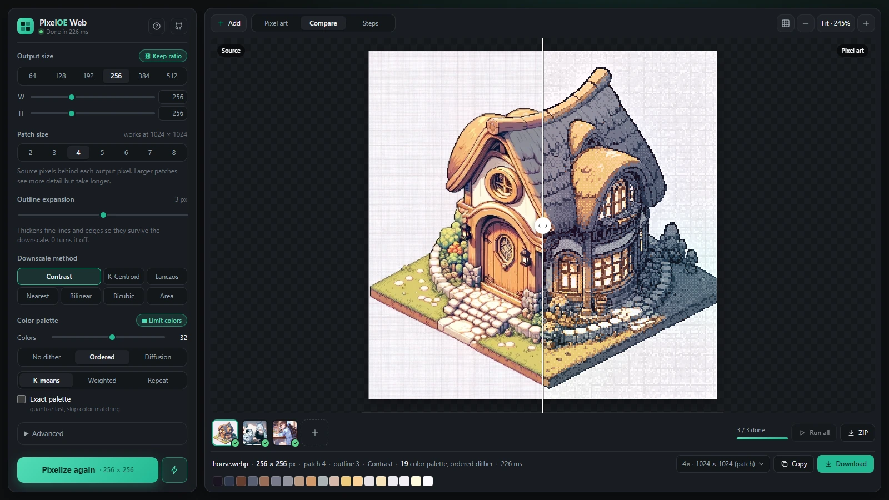

# PixelOE Web

Turn any picture into pixel art in the browser, with
[PixelOE](https://github.com/KohakuBlueleaf/PixelOE/tree/v1.0.0)'s contrast-aware outline expansion.
It is a static site with no build step, no server-side processing and no dependencies. Pictures
never leave your device.



PixelOE uses classic image processing, not a neural network. Before downscaling, it thickens the
thin lines and small highlights that a plain resize would lose. Then it picks each output pixel with
a contrast-aware rule. This app is a JavaScript port of the v1.0.0 torch pipeline, checked
numerically against it (see [Fidelity](#fidelity)).

## Features

- **The whole pipeline.** Outline expansion (thickness 0–6, three weight mappings), color matching,
  seven downscale methods (contrast, k-centroid, Lanczos, nearest, bilinear, bicubic, area),
  optional unsharp or Laplacian sharpening, and palette reduction (2–256 colors; k-means, weighted
  or repeat k-means; no dither, ordered or error-diffusion dithering). "Exact palette" matches the
  demo's *quantize after pixelization*.
- **Live preview.** Changes apply as you make them. Each pipeline stage is cached, so changing
  the palette or downscale method re-runs only what depends on it. The work runs in a Web Worker,
  so the page stays responsive.
- **Viewer.** Zoom (wheel, pinch, buttons), pan, and an optional pixel grid. **Compare** shows a
  before/after split, and **Steps** shows the pipeline's intermediate images (resized input, weight
  map, dilated, eroded, expanded), like the demo's Outline Expansion tab.
- **Export.** Download or copy a PNG at 1×–16× (the default matches the patch size, like
  upstream), named the way the upstream demo names files. Palette colors can be copied as hex.
- **Batch runs.** Pick, drop or paste up to 24 pictures. A strip under the viewer shows them all;
  click one (or press <kbd>←</kbd>/<kbd>→</kbd>) to tune its settings live. **Run all** processes
  every picture with the current settings, one after another; each picture keeps the chosen longest
  side and its own proportions. **ZIP** downloads every result (processing any that are out of
  date first). The limit keeps memory in check, because every original file stays in the tab until
  it is removed.
- Drop, paste (<kbd>Ctrl</kbd>+<kbd>V</kbd>) or pick pictures, or start from a sample. Settings
  are remembered. There are light and dark themes, and the layout works on phones.

Keyboard: hold <kbd>Space</kbd> to see the source, <kbd>G</kbd> pixel grid, <kbd>0</kbd> fit,
<kbd>1</kbd> actual pixels, <kbd>+</kbd>/<kbd>−</kbd> zoom, <kbd>Ctrl</kbd>+<kbd>S</kbd> download, <kbd>←</kbd>/<kbd>→</kbd>
previous / next picture.

## Run it

Any static file server works. Module workers don't load from `file://`, so opening
`index.html` directly won't work:

```bash
python -m http.server 8000
# then open http://localhost:8000
```

Pushing to `main` publishes the site to GitHub Pages (`.github/workflows/pages.yml`).

## Layout

| path | what |
| --- | --- |
| `index.html`, `app/style.css`, `app/main.js` | the UI: settings rail, viewer, export |
| `app/worker.js` | runs the pipeline off the main thread, caches each stage of the active picture |
| `app/helper.js` | a thread of the worker's pool, for the per-channel pieces |
| `app/pixeloe.js` | the PixelOE port: pure functions on planar float32 images, no DOM (also runs in Node) |
| `app/samples/` | sample pictures from the PixelOE repository |
| `tools/reference.py` | dumps outputs of the upstream torch pipeline |
| `tools/compare.mjs` | compares the port against those dumps |

## Fidelity

`app/pixeloe.js` mirrors `pixeloe/torch/*.py` function by function, quirks included: zero-padded
morphology, torch's lower median, the lattice overlap-add local statistics, bilinear/bicubic
`F.interpolate` conventions, PIL's antialiased bicubic pre-resize, and the row-pair error diffusion.
To check it:

```bash
git clone --branch v1.0.0 https://github.com/KohakuBlueleaf/PixelOE ../PixelOE
python tools/reference.py ../PixelOE      # needs torch, numpy, pillow; writes out/ref/
node tools/compare.mjs                    # 33 cases: every mode, thickness, mapping, palette option
```

The weight map, expanded image and non-palette results agree to float rounding (mean difference
around 1e-6, no 8-bit value more than one level off beyond 0.03% of values). There are two known,
bounded differences:

- **k-centroid:** when a patch splits into two equal halves, both centroids tie exactly. Torch
  breaks the tie on rounding noise, either way. The port always takes the first, as upstream's
  Slang backend does.
- **k-means palettes:** float summation order can nudge a centroid, so a few pixels may pick a
  neighboring palette color.

Upstream uses kornia's Lab conversion when kornia is installed. The port implements PixelOE's own
fallback conversion. The two differ only slightly.

## Credits

PixelOE is by Shin-Ying Yeh ([KohakuBlueleaf](https://github.com/KohakuBlueleaf)) and is licensed
under Apache-2.0. The k-centroid downscale algorithm is by Astropulse. The sample pictures are from
the PixelOE repository.

This port is licensed under Apache-2.0 as well; see [LICENSE](LICENSE).
